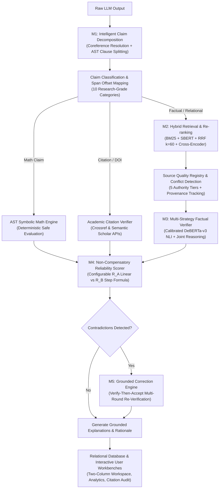

# TruthGuard 3.0: System Architecture Specification

## 1. Executive Summary & Paradigm
**TruthGuard 3.0** is an evidence-grounded, claim-level hallucination detection, scoring, and grounded correction platform. It processes complex LLM-generated outputs through a seven-stage pipeline:
$$\text{Decompose (M1)} \longrightarrow \text{Retrieve (M2)} \longrightarrow \text{Verify (M3)} \longrightarrow \text{Score (M4)} \longrightarrow \text{Correct (M5)} \longrightarrow \text{Re-Verify} \longrightarrow \text{Explain}$$



---

## 2. Component Subsystems

### Subsystem M1: Intelligent Claim Decomposition
- **Coreference Resolution**: Resolves third-person pronouns (`he`, `she`, `it`, `they`, `his`, `her`, `its`, `their`) to salient grammatical subjects across multi-sentence documents while filtering possessive pronoun children.
- **AST Compound Clause Splitting**: Parses dependency trees, coordinates ROOT and conjunction verbs (`conj`), extracts independent spatiotemporal anchors (location vs. date), and segments relative clauses.
- **Exact Span Offset Mapping**: Maps character offsets strictly to original input string boundaries to prevent drifting under pronoun expansions.
- **Claim Classification**: Classifies claims into 10 categories: Mathematical, Numerical, Temporal, Geographical, Named Entity, Scientific, Relational, Subjective Opinion, Prediction, Non-verifiable.

### Subsystem M2: Advanced Hybrid Evidence Retrieval
- **Sparse BM25 Indexing**: Keyword matching using BM25Okapi over tokenized premise sentences.
- **Dense Semantic Retrieval**: Bi-encoder sentence embeddings via `sentence-transformers/all-MiniLM-L6-v2`.
- **Reciprocal Rank Fusion (RRF)**:
  $$\text{RRF}(d) = \frac{1}{60 + \text{rank}_{\text{BM25}}(d)} + \frac{1}{60 + \text{rank}_{\text{Dense}}(d)}$$
- **Cross-Encoder Reranking**: Sequence pair scoring via `cross-encoder/ms-marco-MiniLM-L-6-v2`.
- **5-Tier Source Authority Registry**:
  - Tier 1: Institutional / Government / Academic (0.95 weight)
  - Tier 2: Authoritative Wire & Curated Encyclopedias (0.85 weight)
  - Tier 3: Established Technology & Documentation (0.70 weight)
  - Tier 4: General Commercial Web Content (0.50 weight)
  - Tier 5: Unverified User-Generated Blogs & Media (0.30 weight)
- **Cross-Source Conflict Detection**: Identifies date discrepancies, numeric divergence, and polarity/negation mismatches between competing retrieved passages.

### Subsystem M3: Multi-Strategy Verification Engine
- **3-Class Calibrated NLI**: DeBERTa-v3 Large predicts $P(E)$, $P(C)$, and $P(N)$.
- **Temperature Scaling**: Logits scaled by temperature $T^*$ optimized via L-BFGS minimizing Negative Log-Likelihood on held-out validation sets.
- **Multi-Evidence Joint Reasoning**: Synthesizes premise pairs $(e_1 + " " + e_2, c)$ to support multi-hop factual deduction.
- **Symbolic Math Evaluator**: Sandboxed AST node evaluation supporting arithmetic, comparisons, expressions, and word problems.
- **Temporal Reasoning**: Analyzes historical publication dates against temporal anchors ("current", historical years) to isolate temporal drift.
- **Knowledge Graph Triple Extraction**: Dependency-driven Subject $\to$ Predicate $\to$ Object extraction.

### Subsystem M4: Explainable Non-Compensatory Scoring
- **Claim-Level Reliability**:
  $$\rho(c) = P(E) + \lambda_{\text{NEI}} P(N), \quad \lambda_{\text{NEI}} = 0.50$$
- **Configurable Overall Scoring Strategies**:
  - Strategy A (Continuous Linear Penalty):
    $$R_A(a) = \min\left(\frac{1}{n}\sum_{i=1}^n \rho(c_i), \; 1 - \max_i P_C(c_i)\right)$$
  - Strategy B (Discontinuous Step Capping):
    $$R_B(a) = \begin{cases} \min(\bar\rho, 0.15) & \text{if } \max_i P_C(c_i) \ge \tau_c \\ \bar\rho & \text{otherwise} \end{cases}$$
- **Natural Language Rationale Generator**: Automatically constructs transparent explanations citing exact conflicting facts, probabilities, and sources.

### Subsystem M5: Verified Grounded Correction
- **Verify-Then-Accept Gate**: Generates minimal revisions for contradicted claims; accepts only when re-verification confirms the revision as `SUPPORTED`.
- **Error Span Isolation**: Token alignment and entity divergence matching between claim and evidence.
- **Right-to-Left Merge**: Merges accepted revisions using descending character offsets to eliminate index drift.

### Subsystem Phase 6: Academic Citation Verifier
- Parses inline DOIs, ArXiv IDs, and author-year bibliographic entries.
- Queries Crossref REST API, Semantic Scholar Graph API, and a local landmark registry.
- Classifies citations into `VERIFIED`, `PARTIALLY_VERIFIED`, `CITATION_MISMATCH`, and `POTENTIALLY_FABRICATED`.

### Subsystem Phase 7: Multilingual Architecture
- Automatic script-based language identification (English vs. Hindi).
- Devanagari numeral normalization (`०-९` $\to$ `0-9`).
- Hindi clause splitting across Purna Viram (`।`) and coordinating conjunctions (`और`, `तथा`, `लेकिन`).

---

## 3. Technology Stack & Deployment Architecture

```text
[Frontend: React 19 + Vite + Tailwind CSS]
        │
        │ HTTP REST / JSON (Port 5173 -> Port 8000)
        ▼
[FastAPI REST API Server (Python 3.11)]
        │
   ┌────┴───────────────────────────┬───────────────────────────┐
   ▼                                ▼                           ▼
[TruthGuard Core NLP]       [SQLAlchemy ORM]            [External Registries]
- DeBERTa-v3 NLI            - SQLite / PostgreSQL       - Crossref REST API
- SentenceTransformers      - 10 Relational Tables      - Semantic Scholar API
- spaCy AST Parsing         - Connection Pooling        - Wikipedia Live Extracts
- Symbolic Math Engine
```
